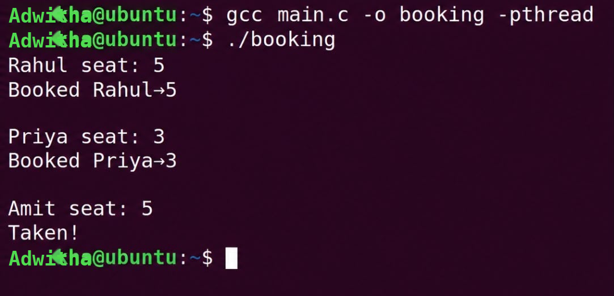
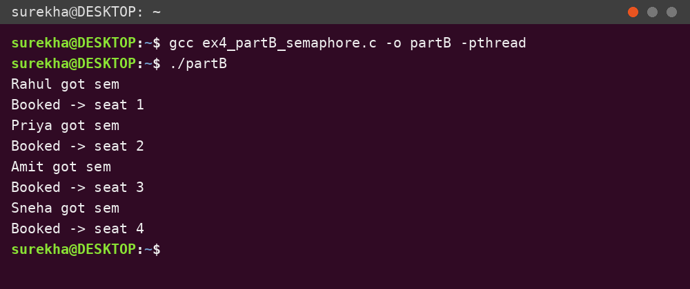
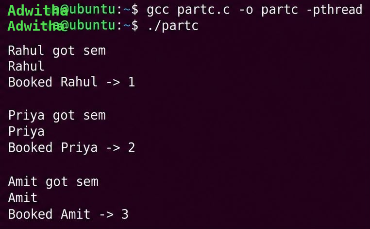

EX NO 4 – Mutual Exclusion using Semaphore and Monitor
Aim
To implement Mutual Exclusion using semaphore and monitor.
Domain / Use Case
Concurrent seat booking system (11 seats, several people booking at the same time).
Files
File	Description
`ex4_partA_mutual_exclusion.c`	Part A – mutual exclusion using a mutex
`ex4_partB_semaphore.c`	Part B – mutual exclusion with a semaphore (3 at a time)
`ex4_partC_semaphore_monitor.c`	Part C – semaphore + monitor (mutex and condition variable)
`ex4_partA_output.png`, `ex4_partB_output.png`, `ex4_partC_output.png`	Program outputs
Part A – Mutual Exclusion (mutex)
Three threads (Rahul, Priya, Amit) each lock a mutex, read a seat number, book it if free, otherwise print `Taken!`, then unlock. Only one thread is inside the critical section at a time.
```bash
gcc ex4_partA_mutual_exclusion.c -o partA -pthread
./partA
```

Part B – Mutual Exclusion with Semaphore
Four threads (Rahul, Priya, Amit, Sneha) compete for seats. A semaphore initialised to 3 lets at most 3 threads in at once, and a mutex protects the seat array.
```bash
gcc ex4_partB_semaphore.c -o partB -pthread
./partB
```

Part C – Semaphore and Monitor
Adds a condition variable (monitor): a thread waits with `pthread_cond_wait()` while its seat is occupied, and the seat is released with `pthread_cond_broadcast()` after use.
```bash
gcc ex4_partC_semaphore_monitor.c -o partC -pthread
./partC
```

Definitions
Mutual Exclusion – only one process/thread may enter a critical section and use a shared resource at a time.
Semaphore – a synchronization variable holding a counter, used through `wait()` and `signal()` to control access to shared resources.
Monitor – a high-level mechanism combining shared data, procedures and synchronization in one unit; only one thread runs inside it at a time and condition variables make threads wait or continue.
Result
Successfully executed Mutual Exclusion using semaphore and monitor.
